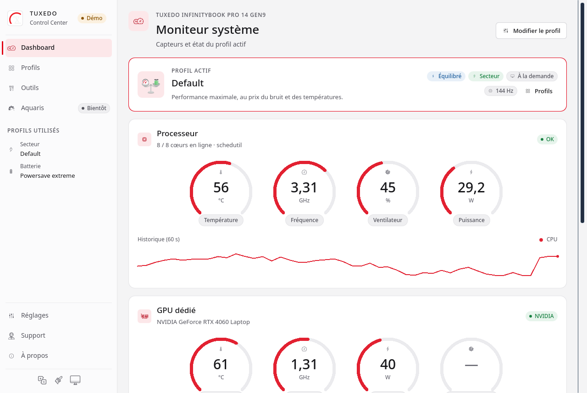
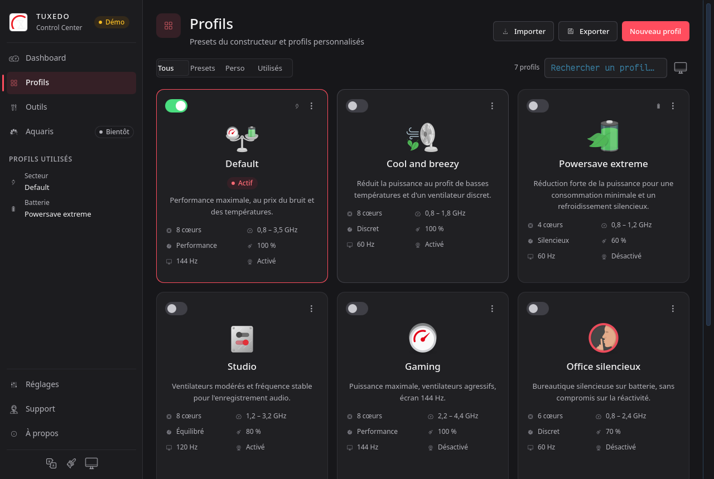

# TuxedoRustCenter

[](https://github.com/fnyaker/TuxedoRustCenter/actions/workflows/ci.yml)
[](https://github.com/fnyaker/TuxedoRustCenter/releases)
[](LICENSE)
[](rust-toolchain.toml)
[](https://www.qt.io/)

**A 100% Rust rewrite of [TUXEDO Control Center](https://github.com/tuxedocomputers/tuxedo-control-center).**
A native Qt 6 GUI, a privileged Rust daemon and an unprivileged session agent:
no Electron, no Angular, no web components, no Node or Python runtime.

| Dashboard | Profiles |
|---|---|
|  |  |

## Why a rewrite

The original stacks an Electron/Angular GUI, a packaged Node.js daemon and a
C++ addon, all installed under `/opt`. TuxedoRustCenter keeps the same hardware
features on a fully native stack:

- **smaller footprint, faster start** — GUI ~300 ms and 127 MiB with software
  rendering, daemon ~0.3% CPU and 15 MiB RSS at rest (measured, see
  `docs/STATUS.md`);
- **reduced attack surface** — three separate processes, no setuid, polkit for
  sensitive operations, no shell command construction;
- **FHS installation** — `/usr`, `/etc`, `/var/lib`, `/run`; nothing in `/opt`;
- **modern integration** — power-profiles-daemon, UPower, systemd, Wayland,
  journald;
- **verifiable behaviour** — hardware logic testable against a fake sysfs, CI
  that never needs a TUXEDO laptop.

## Features

### Profiles and automatic switching

- TUXEDO profiles (Max Energy Save, Quiet, Office, High Performance) and custom
  profiles: create, duplicate, validated import/export.
- Automatic switching on a **power-profiles-daemon × power source** matrix
  (3 × 2), AC/battery fallback, debounce, temporary manual override that is
  cleared when the state changes.
- PPD stays the owner of `platform_profile` and EPP; TCC owns CPU limits, fans,
  display, webcam and charging.
- A profile applies everything: CPU, fans, display, webcam, charging, ODM, TDP,
  cTGP, Fn-Lock.

### Hardware

- **CPU**: online cores, governor, min/max frequency, EPP, `no_turbo`, quirks
  for `intel_pstate` / `amd-pstate-epp` / `acpi-cpufreq`.
- **Fans**: `tuxi`, `pwm` and `tuxedo-io` backends, drag-and-drop CPU/GPU curves,
  min/max/offset, hysteresis, automatic mode restored on exit.
- **Charging**: profile, priority, start/end thresholds, charge type.
- **Lighting**: white keyboard, RGB zones, per-key, lightbar, static and
  breathing modes.
- **Webcam**: hardware kill switch, UVC controls through V4L2.
- **ODM / TDP / NVIDIA**: `tuxedo_platform_profile`, PL1/PL2/PL4 through
  `tuxedo-io`, cTGP offset, PRIME state (read-only).
- **Sensors**: temperatures, frequencies, power (RAPL, hwmon, NVIDIA), fan
  speeds; collection only while a client asks for it.
- **Misc**: Fn-Lock, YCbCr 4:2:0, brightness, suspend/resume, shutdown timer
  through logind.

### Display

- **Internal panel refresh rate per profile**, on X11 (native XRandR through
  `x11rb`) and Wayland: Hyprland, Sway, KDE (`kscreen-doctor`), GNOME/Mutter.
- Only `eDP-*`, `LVDS-*` or `DSI-*` are ever targeted: external monitors are
  never touched.
- Optional per-profile resolution, 0.5 Hz tolerance, clean failure and an
  "unsupported" state surfaced in the UI.

### Interface

- Native Qt 6 (QML + cxx-qt): Dashboard with gauges and history, Profiles,
  profile editor, Tools, Settings, Support, About.
- Light/dark/system themes, TUXEDO red `#E30016` accent, bundled Titillium Web
  font.
- Native tray (`Qt.labs.platform`): active profile, quick switch, Fn-Lock,
  sleep inhibitor, autostart.
- **EN/FR/DE** i18n, °C/°F, reduced motion, keyboard navigation.
- Clean degraded mode when the daemon is absent.

### Command line

`tcc-cli` exposes `status`, `profiles`, `settings`, `fans`, `hardware`,
`sensors`, `timer`, `admin`, `ping`, `set-temp`, `clear-temp`.

## Platforms

| Package | Target | Status |
|---|---|---|
| `.pkg.tar.zst` | Arch Linux and derivatives (EndeavourOS, CachyOS, Manjaro…) | built and tested |
| `.deb` | Ubuntu 24.04 LTS | built and tested |
| `.rpm` | Fedora | built and tested |

Packages are built automatically by GitHub Actions on every `v*` tag and
attached to the release with SHA-256 checksums.

On a TUXEDO laptop, `tuxedo-drivers` (or `tuxedo-keyboard`) is recommended for
fans, charging, lighting and `tuxedo-io`. On other machines the application
still runs: missing features are detected and reported as unavailable, never
simulated.

## Installation

Download the package from the [latest release](https://github.com/fnyaker/TuxedoRustCenter/releases):

```sh
# Arch and derivatives
sudo pacman -U tuxedo-rust-center-*.pkg.tar.zst

# Ubuntu 24.04
sudo apt install ./tuxedo-rust-center_*_amd64.deb

# Fedora
sudo dnf install ./tuxedo-rust-center-*.rpm
```

Then enable the services:

```sh
sudo systemctl enable --now tccd          # privileged daemon
systemctl --user enable --now tccd-user   # session agent (refresh rate)
```

The package is `Conflicts`/`Provides` with `tuxedo-control-center`: it replaces
the original, but removing it and migrating profiles is covered in
[`docs/packaging/MIGRATION.md`](docs/packaging/MIGRATION.md).

### Omarchy bar widget

On Omarchy, add the bar widget (CPU load, battery power, active profile and
profile switcher) with one command:

```sh
omarchy plugin add https://github.com/fnyaker/omarchy-tcc-stats.git --enable
```

It calls `tcc-cli`, so the package above must be installed. Without network
access, `tcc-cli omarchy-plugin install` followed by
`omarchy plugin enable tuxedo.tcc-stats` installs the copy shipped in the
package.

### Building from source

Requirements: Rust 1.85+, Qt 6 (Core, Gui, Widgets, Quick, QuickControls2),
CMake, Ninja, pkg-config. Per-distribution details in
[`docs/DEV_SETUP.md`](docs/DEV_SETUP.md).

```sh
cargo build --release --workspace
cargo test --workspace
```

Rootless development stack on the session bus:

```sh
./scripts/dev-session.sh
```

Local packages (`deb`, `rpm`, Arch):

```sh
scripts/release/build.sh            # .deb
scripts/release/build.sh --rpm      # + RPM
scripts/release/build.sh --arch     # + Arch package
```

## Architecture

```
┌───────────────────────────────────────────────┐
│ tcc-gui — native Qt 6 GUI (user)              │
└─────────────┬─────────────────────┬───────────┘
              │ system D-Bus        │ system D-Bus (polkit)
┌─────────────▼──────────────┐  ┌───▼─────────────────────────┐
│ tccd — root daemon         │  │ tccd-admin — on-demand root │
│ profiles, workers, hardware│  │ persistent writes,          │
│                            │  │ ODM/TDP/cTGP                │
└─────────────┬──────────────┘  └─────────────────────────────┘
              │ active profile signal
┌─────────────▼──────────────┐
│ tccd-user — session agent  │
│ refresh rate, compositor   │
└────────────────────────────┘
```

| Crate | Role |
|---|---|
| `tcc-core` | models, profiles, settings, switching engine, migration, validation |
| `tcc-ipc` | typed, versioned D-Bus contracts (`Manager1`, `Admin1`, `Admin.Hw`, `User1`) |
| `tcc-hw` | sysfs, hwmon, `tuxedo-io` ioctls, DMI, DRM, V4L2, display backends |
| `tcc-daemon` | `tccd` binary: orchestration, workers, persistence, system D-Bus |
| `tcc-admin` | `tccd-admin` binary: sensitive operations, polkit, on demand |
| `tcc-user` | `tccd-user` binary: session agent, refresh rate and resolution |
| `tcc-gui` | Qt 6 binary (`cxx-qt` + QML) |
| `tcc-cli` | unprivileged diagnostic tool |
| `tcc-authz` | shared polkit client, fail-closed |

`tccd-admin` is **not** installed by the default packages: it is only shipped
when the package is built with `TCC_WITH_ADMIN=1`, until polkit authorisation
and the persistence transaction are validated on a real system bus.

## Security

- No setuid; GUI and session agent unprivileged; minimal root daemon.
- Persistent writes and sensitive hardware operations go through `tccd-admin`
  + polkit (`system-bus-name`, fail-closed) with backup and rollback.
- Mutable state lives in `/var/lib/tuxedo-rust-center`; `/etc` is read-only for
  the daemon; atomic writes, explicit permissions.
- No interpolated shell commands, argument allowlists, strict validation of
  D-Bus input and imported profiles.
- Hardened systemd units (`ProtectSystem=strict`, `PrivateDevices` +
  `DeviceAllow`, `SystemCallFilter`, `CapabilityBoundingSet=`, `LimitCORE=0`,
  `ProtectKernelTunables=no` to keep `/sys` writable).
- LUKS password change: **out of scope**, not implemented.

See [`SECURITY.md`](SECURITY.md) and [`docs/security/THREAT_MODEL.md`](docs/security/THREAT_MODEL.md).

## Project status

Milestone 2: daemon, session agent and GUI are functional; profiles, PPD × power
switching, CPU, brightness, fans, charging, lighting, ODM/TDP/cTGP, sensors,
PRIME/YCbCr read-only, refresh rate on X11 and Wayland. 1,500+ Rust tests and
300+ QML tests pass; deb/rpm/Arch packages validated in containers.

Known limitations, kept up to date in [`docs/STATUS.md`](docs/STATUS.md):

- UVC writes: real-device read tested, real write not yet;
- TDP and cTGP depend on firmware and GPU, not testable on every model;
- `Admin.Prime`, Tomte, WebFAI and Aquaris are not implemented yet.

## Documentation

- [`AGENTS.md`](AGENTS.md) — project rules and constraints.
- [`docs/ARCHITECTURE.md`](docs/ARCHITECTURE.md) — analysis of the original and target architecture.
- [`docs/FEATURE_PARITY.md`](docs/FEATURE_PARITY.md) — feature parity, item by item.
- [`docs/STATUS.md`](docs/STATUS.md) — verified state, measurements and known limits.
- [`docs/DBUS_API.md`](docs/DBUS_API.md) — D-Bus API and payloads.
- [`docs/user/GUIDE.md`](docs/user/GUIDE.md) — user guide.
- [`docs/packaging/README.md`](docs/packaging/README.md) — packages and system integration.
- [`docs/security/`](docs/security/) — threat model and decisions.

## Contributing

Contributions are welcome: bug reports, hardware testing, translations, support
for more Wayland compositors. Please read [`AGENTS.md`](AGENTS.md) and
[`docs/QUALITY.md`](docs/QUALITY.md) (quality gates: `cargo fmt`,
`clippy -D warnings`, tests, security review).

The upstream TCC reference code is not vendored here: fetch it into
`tuxedo-control-center-master/` (git-ignored) to compare a behaviour.

## License

[GPL-3.0-or-later](LICENSE). TuxedoRustCenter is an independent rewrite; see
[`NOTICE.md`](NOTICE.md) for attribution and asset provenance.
